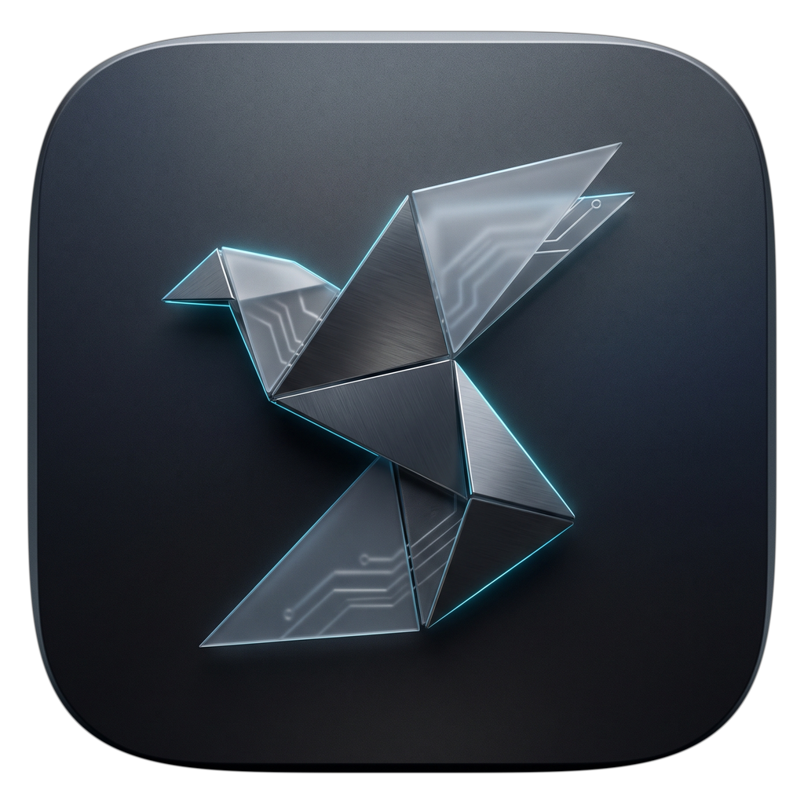

<p align="center">
  
</p>

<h1 align="center">Swifter</h1>

<p align="center">
  <strong>Fast, lightweight packaging engine that turns standalone Windows executables (<code>.exe</code>) into native, self-contained macOS application bundles (<code>.app</code>).</strong>
</p>

<p align="center">
  
  
  
  
  
  
</p>

---

## User Guide

### What is Swifter?

**Swifter** is a modern macOS desktop utility that packages standalone Windows executables (`.exe`), game folders, and portable software into native, ready-to-click macOS application bundles (`.app`).

Instead of cloning multi-gigabyte virtual Windows drives for every app, Swifter provisions ultra-lightweight **micro-prefixes** and configures graphics translation layers automatically. Execution is delegated to standard Wine runtimes while keeping user settings, save games, and registry states completely isolated per application.

### Key Features

* **Direct Folder & Executable Ingestion**: Drag and drop any `.exe` or application folder. Swifter inspects binary headers (PE32/PE32+), detects game engine signatures (Unity, Unreal, Godot, GameMaker, LibGDX, Java), and preserves companion data trees and DLLs intact.
* **Native Icon Extraction**: Directly parses Windows PE `RT_GROUP_ICON` resources in Rust and compiles multi-resolution Apple `.icns` containers (16x16 to 1024x1024) without third-party converters.
* **Isolated Micro-Prefixes**: System directories (`system32`, `syswow64`, `fonts`) symlink to a shared base runtime, while `AppData`, user directories, and registry hives stay isolated per application.
* **Selectable Graphics Translation**:
  * **DXVK**: DirectX 9, 10, and 11 translation to Vulkan via MoltenVK.
  * **Apple D3DMetal**: DirectX 11 and 12 translation to Apple Metal on Apple Silicon (via Apple Game Porting Toolkit).
  * **WineMetalGL & WineD3D**: OpenGL 1.0–4.6 to Apple Metal translation layer for 2D/3D software and legacy utilities.
* **Retina High-DPI Scaling & Display Controls**: Configure native 2x Retina buffer rendering and Windows UI/font scaling presets (100% / 96 DPI, 125% / 120 DPI, 150% / 144 DPI, 200% / 192 DPI) syncing directly with prefix registry (`LogPixels` & `RetinaMode`).
* **Quick Troubleshooting Tools & Diagnostic Logs**: In-app one-click access to prefix utilities (`winecfg`, `regedit`, `taskmgr`, `cmd`, interactive prefix Terminal shell, force-quit process killer, and real-time `last_run.log` viewer).
* **Launch Arguments, Custom Env & DXVK HUD Presets**: Custom command-line flags, environment variable overrides, and one-click quick presets for DXVK on-screen performance overlay (`DXVK_HUD=fps`, `fps,devinfo`, `full`).
* **Common Windows Dependencies & Font Aliasing**: Auto-provisions Microsoft Visual C++ 2015–2022 x64 runtime and links macOS system fonts to standard Windows typefaces (Arial, Segoe UI, Tahoma, Consolas).
* **Resilient Dynamic Runtime Downloader**: Zero hardcoded download sizes. Resolves asset sizes dynamically via GitHub Releases API and HTTP Range headers, complete with a multi-mirror failover pipeline and archive magic byte verification.
* **Installer Wizard Support**: Run Windows setup wizards inside an isolated prefix, then package the installed executable directly.
* **Application Library**: Launch packaged apps, inspect configurations, reveal bundles in Finder, or access isolated `AppData` directories with one click.

### Comparison

| Feature | Traditional Wine Managers | Swifter |
| :--- | :--- | :--- |
| **Storage per App** | 1.5 GB – 2.5 GB (full virtual `C:` drive) | **Micro-prefix** using shared system symlinks |
| **Directory Context** | Often requires full installer re-run | **Preserves full folder tree (`*_Data`, companion DLLs)** |
| **Icon Handling** | Generic icons or manual user setup | **Automatic PE header extraction to `.icns`** |
| **High-DPI / Retina** | Often blurry or microscopic in-game text | **Built-in Retina Mode & DPI presets (96–192 DPI)** |
| **Troubleshooting** | Complex terminal commands or deep menus | **1-click tools: winecfg, regedit, logs, shell** |
| **Dock Integration** | Ghost launcher icons or terminal windows | **Native Dock & App Switcher (`Cmd+Tab`) integration** |
| **Workflow** | Multi-step bottle creation | **Drop file → Review options → Pack with Swifter** |

### How to Use

1. **Install Runtime**: Open **Settings**. Ensure Wine is installed (use the 1-Click Install button, or route to existing Homebrew Wine, Whisky, or CrossOver).
2. **Select Application**: In **Convert**, drag & drop a Windows `.exe` or application folder, or click to browse Finder.
3. **Configure Options**: Review executable architecture, app name, recommended graphics backend, Retina mode, DPI scaling, and launch arguments. (If dropping an installer wizard, click *Run Setup Wizard in Micro-Prefix* first).
4. **Pack**: Click **Pack with Swifter**. Your new `.app` bundle will appear in your **Library** and `/Applications` folder.

### macOS Gatekeeper Note

Swifter is an open-source project distributed freely without a paid Apple Developer certificate. If macOS flags downloaded builds as damaged or unverified, run this command in **Terminal**:

```bash
xattr -cr /Applications/Swifter.app
```

*(Or open **System Settings** → **Privacy & Security** → scroll to Security → click **Open Anyway**).*

---

## Developer Guide

### Architecture

```text
swifter/
├── crates/
│   └── swifter-core/            # Pure headless Rust packaging engine
│       ├── recipes/             # Bundled engine translation presets
│       └── src/
│           ├── analyzer/        # PE parsing, folder heuristics & icon extraction
│           │   ├── pe_parser.rs
│           │   ├── folder_scan.rs
│           │   └── icon_extract.rs
│           └── engine/          # Prefix management, launcher shim & downloader
│               ├── prefix_mgr.rs
│               ├── launcher_shim.rs
│               ├── bundle_builder.rs
│               ├── runtime_downloader.rs
│               └── recipes.rs
├── apps/
│   ├── desktop/                 # Tauri native desktop harness
│   │   ├── src/
│   │   │   ├── main.rs          # macOS desktop harness entrypoint
│   │   │   ├── lib.rs           # Plugin registry & lifecycle
│   │   │   └── commands.rs      # Native IPC command bridges
│   │   ├── tauri.conf.json      # Tauri application configuration
│   │   └── package.json
│   └── ui/                      # SvelteKit 5 + Tailwind CSS v4 Frontend
│       ├── src/
│       │   ├── routes/          # Navigation & page routing
│       │   ├── components/      # UI components (Dropzone, Inspector, Shelf, etc.)
│       │   └── lib/             # Typed Tauri IPC bridges & version helper
│       └── package.json
├── scripts/
│   └── sync-version.js          # Dynamic version synchronization script
├── VERSION                      # Single-source-of-truth version string
├── Cargo.toml                   # Root Cargo workspace (workspace.package)
└── package.json                 # Root Bun workspace & task orchestration
```

### Prerequisites

* **macOS**: 12.0 (Monterey) or later (Apple Silicon or Intel).
* **Rust**: 1.80+ (`cargo --version`)
* **Bun**: 1.1+ (`bun --version`)

### Development

```bash
# Clone repository
git clone https://github.com/msandypr/swifter.git
cd swifter

# Install dependencies
bun install

# Run development server with hot-reload
bun run dev
```

### Dynamic Versioning

Swifter features single-file dynamic versioning. Changing the version propagates across all Cargo manifests, Tauri configurations, Svelte UI views, and binaries automatically:

```bash
# Bump version to a new release (e.g. 1.0.0 or 1.1.0)
bun run bump 1.0.0

# Or manually update "version" in root package.json, then run:
bun run version:sync
```

### Verification & Testing

```bash
# Rust workspace unit and integration tests (16 tests)
bun run test
# or: cargo test --workspace

# Svelte 5 / TypeScript type-check
bun run check

# Desktop release build (compiles macOS .app and .dmg)
bun run build
```

### Building Release Bundles

```bash
bun run build
```

Compiled release artifacts will be output to:
* `target/release/bundle/macos/Swifter.app`
* `target/release/bundle/dmg/Swifter_1.0.0_aarch64.dmg`

---

## Open-Source Credits & Upstream Projects

Swifter is built upon and orchestrates several upstream open-source projects:

* **[WineHQ](https://www.winehq.org) & [Gcenx](https://github.com/Gcenx/macOS_Wine_builds)**: Windows API translation layer and official standalone macOS binary packages maintained by Dean M. (Gcenx).
* **[DXVK](https://github.com/doitsujin/dxvk)**: Vulkan-based translation layer for Direct3D 9, 10, and 11 by Philip Rebohle.
* **[MoltenVK](https://github.com/KhronosGroup/MoltenVK)**: Khronos Group implementation of the Vulkan graphics API mapped over Apple Metal.
* **[WineMetalGL](https://github.com/MetalSharp/WineMetalGL)**: OpenGL 1.0–4.6 to Apple Metal translation layer by MetalSharp for Apple Silicon.
* **[Tauri](https://github.com/tauri-apps/tauri)**: Memory-safe native application framework and OS webview bridge.
* **[Rust](https://www.rust-lang.org)**: Systems programming language providing high performance and memory safety.
* **[Svelte 5](https://github.com/sveltejs/svelte)**: Reactive UI framework by Rich Harris and contributors.
* **[Tailwind CSS](https://tailwindcss.com)**: Utility-first CSS framework by Tailwind Labs.

### Community & Upstream Etiquette

Swifter is a packaging wrapper and prefix orchestrator. Please respect upstream maintainers:
* **Report to Swifter Issues**: Packaging errors, `.app` bundle structure issues, micro-prefix symlink bugs, UI defects, or launcher script issues.
* **Do NOT report wrapper issues to WineHQ, DXVK, or WineMetalGL bug trackers**: Inherent translation compatibility or rendering issues belong to general Wine/DXVK/WineMetalGL discussions. Never submit tickets about Swifter wrappers to upstream maintainers.

### Author

* **Created by:** [msandypr](https://github.com/msandypr)
* **GitHub Repository:** [https://github.com/msandypr/swifter](https://github.com/msandypr/swifter)

### License

This project is licensed under the **[GNU General Public License v3.0 (GPLv3)](LICENSE)**.
