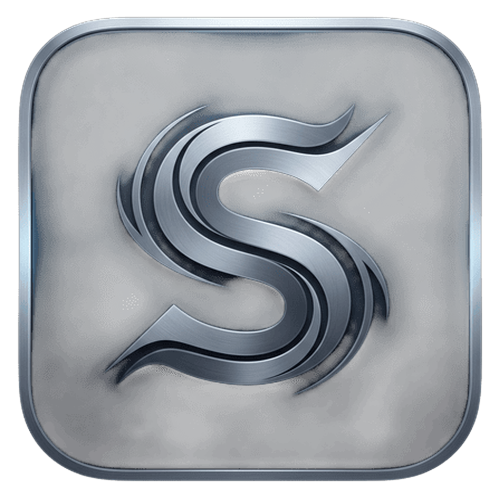

<p align="center">
  
</p>

<h1 align="center">Swifter</h1>

<p align="center">
  <strong>Portable Windows (<code>.exe</code>) to macOS (<code>.app</code>) Packaging Utility</strong><br>
</p>

<p align="center">
  
  
  
  
  
  
</p>

---

## Overview

**Swifter** is a macOS desktop utility built with **Tauri v2**, **Rust**, and **Svelte 5**. It packages standalone, DRM-free Windows executables (`.exe`) and portable game directories into standard macOS application bundles (`.app`).

Built primarily for standalone indie games (such as archives distributed via itch.io or Game Jolt), Swifter operates strictly as a **packaging, prefix-provisioning, and orchestration tool**. It constructs standard macOS bundle structures and manages lightweight Wine prefixes while delegating binary execution to external Wine runtimes. It does not bundle, modify, redistribute, or circumvent proprietary translation layers.

---

### Architectural Comparison

| Aspect | Traditional Bottle Managers | Swifter |
| :--- | :--- | :--- |
| **Prefix Footprint** | 1.5 GB – 2.5 GB per bottle (full virtual `C:` drive) | **~15 MB – 30 MB** per app (symlinked micro-prefix) |
| **Directory Context** | Often targets single `.exe` installers | **Preserves full parent game directory (`*_Data`, `.pck`)** |
| **Icon Handling** | Generic fallback icons or manual image assignment | **Automatic PE `RT_GROUP_ICON` to Apple `.icns` conversion** |
| **Workflow** | Bottle initialization and installer execution | **Direct folder/executable inspection and bundling** |
| **Save Data Access** | Nested inside virtual drive hierarchies | **Direct shortcut to isolated per-game `AppData`** |

---

## Core Features

### 1. Executable & Directory Inspection
Drop a standalone `.exe` or a game directory into the interface. Swifter scans the directory tree, identifies the primary executable, detects the target architecture (32-bit/64-bit) and game engine, and prepares the `.app` bundle layout.

### 2. Directory Context Preservation
Portable Windows games rely on external assets placed relative to the executable. Swifter preserves parent directory structures so Unity data folders (`*_Data`), Godot resource packs (`.pck`), GameMaker archives (`data.win`), and companion DLLs remain accessible at runtime.

### 3. Native PE Icon Extraction
Swifter parses Windows Portable Executable headers directly in Rust using `pelite`. It extracts embedded `RT_GROUP_ICON` resources, resizes the bitmap layers, and compiles a standard multi-resolution Apple `.icns` container (16x16 up to 1024x1024).

### 4. Symlinked Micro-Prefixes (~15–30 MB)
Instead of duplicating a full 2 GB `C:` drive for every packaged title, Swifter provisions an isolated micro-prefix:
- System directories (`system32`, `syswow64`, `fonts`) are symlinked to a shared base runtime.
- User state (`AppData/Local`, `AppData/Roaming`, `Saved Games`, and registry hives) remains strictly isolated per application.

### 5. Configurable Graphics Backends
Users can select the appropriate graphics translation backend per application based on the target engine:

| Backend | Target APIs | Translation Path | Typical Use Case |
| :--- | :--- | :--- | :--- |
| **DXVK** | DirectX 9, 10, 11 | Vulkan via MoltenVK | Unity 3D, Godot, and 3D indie games |
| **Apple D3DMetal** | DirectX 11, 12 | Apple Metal (User-supplied GPTK) | DirectX 11/12 titles on Apple Silicon |
| **WineD3D (Vanilla)** | DirectX 9, OpenGL | OpenGL / Metal via `wined3d` | 2D GameMaker, RPG Maker, and legacy utilities |

### 6. Automated Upstream Runtime Fetcher & BYOR
Swifter does not bundle or redistribute Wine binaries within its repository or installer. To execute packaged applications, Swifter supports:
- **Direct Upstream Fetching:** If no local Wine installation is found, the built-in Runtime Manager downloads pre-built, open-source Wine archives directly from official upstream community releases (such as [Gcenx's macOS Wine builds](https://github.com/Gcenx/macOS_Wine_builds)) and configures the local shared base directory.
- **Bring-Your-Own-Runtime (BYOR):** Automatically detects and routes execution through existing local installations of **Homebrew Wine**, **Whisky**, or a licensed copy of **CrossOver**.

### 7. Application Shelf & Save Data Management
The **Shelf** view lists all packaged `.app` bundles. Users can launch applications, reveal bundles in Finder, or open the application's isolated `AppData` directory to back up or modify save files.

---

## System Architecture

```text
swifter/
├── src-tauri/
│   ├── src/
│   │   ├── main.rs              # Tauri macOS application entrypoint
│   │   ├── lib.rs               # Plugin initialization & command dispatcher
│   │   ├── commands.rs          # IPC bridge (inspect, pack, dry-run, runtime)
│   │   ├── analyzer/
│   │   │   ├── pe_parser.rs     # 32/64-bit detection, PE metadata, DRM/anti-cheat check
│   │   │   ├── folder_scan.rs   # Engine heuristics (Unity, Godot, GameMaker, Unreal)
│   │   │   └── icon_extract.rs  # PE resource parsing to multi-resolution .icns
│   │   └── engine/
│   │       ├── prefix_mgr.rs    # Isolated micro-prefix provisioning (~15MB/app)
│   │       ├── launcher_shim.rs # POSIX launcher script & runtime discovery
│   │       ├── bundle_builder.rs# macOS .app bundle generator (Info.plist, PkgInfo)
│   │       └── recipes.rs       # Engine translation presets & environment variables
├── src/                         # Svelte 5 Frontend
│   ├── routes/
│   │   ├── +layout.svelte       # Application shell & window chrome
│   │   └── +page.svelte         # Main view router & navigation
│   └── components/
│       ├── Dropzone.svelte      # File & directory drop target
│       ├── GameInspector.svelte # Bundle configuration, backend selector, dry-run test
│       ├── ProgressModal.svelte # Packaging step status modal
│       ├── Shelf.svelte         # Packaged app library & AppData shortcuts
│       ├── Settings.svelte      # Upstream runtime fetcher & prefix storage manager
│       ├── Guide.svelte         # Built-in usage documentation
│       └── About.svelte         # Project metadata & license information
└── recipes/
    └── default_recipes.json     # Engine heuristics and environment presets
```

---

## Installation & Prerequisites

### System Requirements
- **Operating System:** macOS 12.0 (Monterey) or later.
- **Architecture:** Apple Silicon (`aarch64`) or Intel (`x86_64`).
- **Wine Runtime:** Swifter generates the `.app` container and manages the prefix, requiring a Wine runtime on the host to run Windows binaries. You can:
  - Fetch an open-source portable Wine build via the in-app Runtime Manager (downloads directly from upstream GitHub releases).
  - Install Wine system-wide via Homebrew:
    ```bash
    brew install --cask wine-stable
    ```
  - Utilize an existing local installation of **CrossOver** or **Whisky**.

---

## Developer Guide

### Prerequisites

Ensure **Rust** and **Bun** (or Node.js) are installed on your system:

```bash
cargo --version
bun --version
```

Clone the repository and install frontend dependencies:

```bash
git clone https://github.com/msandypr/swifter.git
cd swifter
bun install
```

### Development Server

Run the application in development mode with hot-reloading:

```bash
bun run tauri dev
```

### Production Build

Compile release binaries (`.app` and `.dmg`):

```bash
bun run tauri build
```

Build artifacts are output to:
- `src-tauri/target/release/bundle/macos/Swifter.app`
- `src-tauri/target/release/bundle/dmg/Swifter_0.1.0_aarch64.dmg`

### Testing & Verification

Run the Rust unit and integration test suites:

```bash
cargo test --manifest-path src-tauri/Cargo.toml
```

Run Svelte/TypeScript type checks:

```bash
bun run check
```

---

## Usage Workflow

1. **Open Swifter.**
2. **Select Input:** Drag and drop a Windows `.exe` or game folder into the dropzone.
3. **Configure Bundle:**
   - Review the detected architecture and game engine.
   - Select a translation backend (**DXVK**, **D3DMetal**, or **WineD3D**).
   - Choose between **Symlink Mode** (references original game files in place) or **Standalone Copy** (copies game assets inside the `.app` bundle).
4. **Dry Run (Optional):** Click **Dry Run (3s Test)** to verify executable initialization and inspect standard error logs before building the bundle.
5. **Package:** Click **Pack with Swifter** to generate the `.app` bundle inside `/Applications` (or `~/Applications`).
6. **Launch & Manage:** Run the packaged application directly from Finder, Dock, Spotlight, or the Swifter **Shelf**.

---

## Acknowledgments & Legal Disclaimer

- **The Wine Project & CodeWeavers:** Running Windows software on macOS relies heavily on the ongoing engineering efforts of the **Wine Project**, **CodeWeavers**, and upstream macOS maintainers such as **Gcenx**. If you regularly run Windows applications or games on macOS, please consider supporting upstream Wine development by purchasing a [CrossOver](https://www.codeweavers.com/crossover) license.
- **No Proprietary Redistribution:** Swifter does **not** host, bundle, redistribute, or modify proprietary binaries owned by CodeWeavers or Apple Inc. (such as Game Porting Toolkit / D3DMetal). The built-in runtime fetcher connects directly to public, open-source upstream repositories, and D3DMetal options require the user to supply those components legally on their own machine.
- **Intended Use:** Swifter is built strictly for packaging legally obtained, DRM-free software, personal builds, and indie games. It does not bypass DRM, Steamworks, or anti-cheat protections.
- **Trademarks:** macOS, Metal, and Finder are trademarks of Apple Inc. Windows and DirectX are trademarks of Microsoft Corporation. CrossOver is a trademark of CodeWeavers, Inc. All other trademarks are the property of their respective owners.

---

## Author

- **Developer:** [msandypr](https://github.com/msandypr)
- **Repository:** [https://github.com/msandypr/swifter](https://github.com/msandypr/swifter)

---

## License

This project is licensed under the **[GNU General Public License v3.0 (GPLv3)](LICENSE)**.

You are free to use, study, modify, and redistribute this software under the terms of the GPLv3. Any derivative work or modified distribution must remain open-source under the same GPLv3 license with full source code disclosed. Re-licensing this project as closed-source or proprietary commercial software is strictly prohibited.
